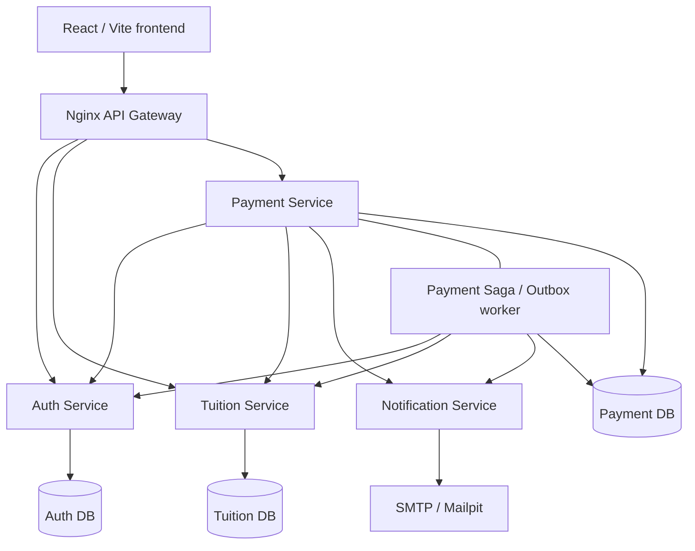
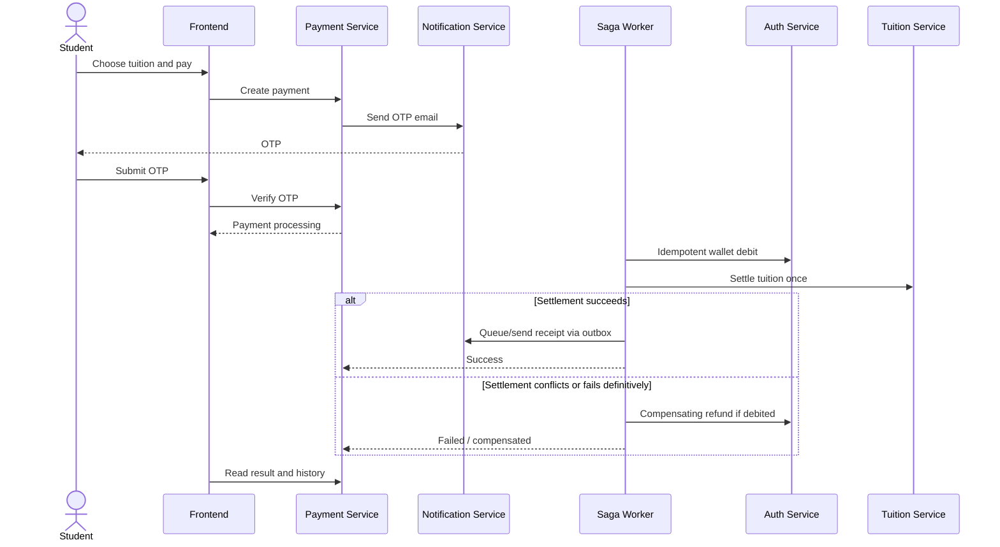

<div align="center">

# iBanking

**A tuition payment system built as real microservices.**

From student sign-in to tuition settlement — with email OTP, recoverable payments, and concurrency-safe updates.

**4 business services · 3 owned databases · 1 API gateway · 1 Saga worker**

[Get started](#quick-start) · [Architecture](#architecture) · [Run tests](#testing) · [Demo checklist](#demo-checklist)

</div>

---

## What is iBanking?

iBanking is an educational tuition-payment platform built for a **Service-Oriented Architecture / Microservices** project. A student signs in, looks up an outstanding tuition bill, confirms payment with a one-time password, and checks the updated balance and transaction history.

The point isn't just to make a payment screen work. It's to keep **money and tuition state consistent**, even when requests race or a downstream service fails.

- **Student experience:** sign in → look up tuition → initiate payment → verify OTP → view result and history.
- **Payment safeguards:** OTP expiration and attempt limits, idempotent debit/refund, database row locks, and a recoverable Saga with compensation.
- **Delivery:** Docker Compose, isolated HTTP E2E tests, PostgreSQL concurrency checks, and Mailpit for safe local email demos.

## Architecture



Each data-owning service has a **separate PostgreSQL database and login role**. Notification sends email without owning a database. The services share a PostgreSQL *server* for deployment convenience, not a common application database.

| Component | Responsibility | Implementation |
| --- | --- | --- |
| Frontend | Student interface and payment flow | React, Vite |
| API Gateway | Public API routing; blocks internal mutation endpoints | Nginx |
| Auth Service | Sign-in, accounts, wallet debit/refund | FastAPI, PostgreSQL |
| Tuition Service | Tuition lookup and single settlement | FastAPI, PostgreSQL |
| Payment Service | Transactions, OTP, orchestration and history | FastAPI, PostgreSQL |
| Payment Worker | Saga retries, compensation, transactional outbox | Python |
| Notification Service | OTP and receipt emails | FastAPI, SMTP / Mailpit |

The gateway exposes `/api/auth/*`, `/api/tuitions/*`, and `/api/payments/*`. Internal debit/refund and tuition settlement routes are **not public gateway endpoints**; they are intended for authenticated service-to-service calls on the Docker network.

Architecture sources: [`docs/microservices-architecture.puml`](docs/microservices-architecture.puml) · [`docs/use-case.puml`](docs/use-case.puml) · [`docs/erd.puml`](docs/erd.puml).

## How a payment works



The worker can retry temporary errors. Payment operations use transaction identifiers to prevent repeated debits or settlements. Receipt email is **at-least-once**, not guaranteed exactly once by SMTP.

## Quick start

**Requirements:** Docker Engine + Docker Compose v2. Choose the setup for your operating system. The app runs in Docker; you do not need to install Node.js or Python on the host.

### Windows — Docker Desktop + OneClick

1. Install [Docker Desktop](https://www.docker.com/products/docker-desktop/), enable **WSL 2 / Linux containers**, and wait until Docker Engine is running.
2. Extract the project and open the root folder (the one containing `ONECLICK-1-START.bat`).
3. Double-click **`ONECLICK-1-START.bat`**, or run it from PowerShell:

   ```powershell
   .\ONECLICK-1-START.bat
   ```

   The launcher checks Docker, creates a new `.env` with randomized credentials if missing, asks for a **Gmail address and Google App Password** when SMTP is not configured, and starts the main application. An existing `.env` is preserved. **Do not use your normal Gmail password.**

4. Open the application and verify the gateway:

   | Page | URL |
   | --- | --- |
   | Student app | **http://localhost:5173/dang-nhap** |
   | API Gateway health | **http://localhost:8080/health** |

   ```powershell
   docker compose ps -a
   curl.exe -i http://localhost:8080/health
   ```

   Expect **HTTP 200** for the gateway. OTP and receipt emails are delivered using the configured Gmail SMTP service to the account's recipient email. A demo account's seeded email may not be accessible, so update its email to an inbox you control before doing a live Gmail demo.

> **Prefer local Mailpit instead of Gmail on Windows?** Set up `.env` (you can let OneClick generate it first), then start the local email overlay from PowerShell:
>
> ```powershell
> docker compose -f docker-compose.yml -f docker-compose.oneclick.yml up -d --build
> ```
> Open **http://localhost:18026** to read OTP/receipt messages. The overlay overrides the notification service's SMTP settings; it is normal that `ONECLICK-1-START.bat` itself still prompts for Gmail when SMTP is unconfigured.

### macOS / Linux — Docker Compose (no `.bat`)

1. Install Docker and Compose:

   - **macOS:** Install [Docker Desktop for Mac](https://www.docker.com/products/docker-desktop/) and start it.
   - **Linux:** Install Docker Engine and the Compose v2 plugin for your distribution. For **Arch Linux**:

     ```bash
     sudo pacman -S docker docker-compose openssl
     sudo systemctl enable --now docker
     sudo usermod -aG docker "$USER"
     # Log out and back in, or use `newgrp docker`, before running without sudo.
     ```

   Verify:

   ```bash
   docker info
   docker compose version
   ```

2. From the project root, create a local configuration **only if `.env` does not exist**:

   ```bash
   cp .env.example .env
   chmod 600 .env
   ```

   Replace the placeholder passwords/secrets in `.env` with independent random values. On macOS or Linux, generate each with `openssl rand -hex 32`. For example:

   ```bash
   openssl rand -hex 32
   ```

   The fields to replace are `POSTGRES_PASSWORD`, `AUTH_DB_PASSWORD`, `TUITION_DB_PASSWORD`, `PAYMENT_DB_PASSWORD`, `JWT_SECRET_KEY`, `INTERNAL_SERVICE_TOKEN`, and `OTP_PEPPER`. Use a different generated value for each field. Set `SEED_DEMO_DATA=true` for a **fresh** local demo. You do **not** need working Gmail credentials when using the Mailpit overlay below.

   > Keep credentials from an existing `.env` if reusing an existing PostgreSQL volume. Never commit `.env` or regenerate database passwords against an initialized volume.

3. Start the **main app with Mailpit** (local OTP/receipt inbox):

   ```bash
   docker compose -f docker-compose.yml -f docker-compose.oneclick.yml config --quiet
   docker compose -f docker-compose.yml -f docker-compose.oneclick.yml up -d --build
   docker compose -f docker-compose.yml -f docker-compose.oneclick.yml ps -a
   curl -i http://localhost:8080/health
   ```

4. Open:

   | Page | URL |
   | --- | --- |
   | Student app | **http://localhost:5173/dang-nhap** |
   | API Gateway health | **http://localhost:8080/health** |
   | Mailpit (OTP and receipts) | **http://localhost:18026** |

   Expect **HTTP 200** at `/health`. `db-bootstrap` and `payment-db-init` can finish with `Exited (0)` because they are one-time initialization jobs. Although named `docker-compose.oneclick.yml`, the overlay is a normal Compose file and works on macOS/Linux too.

> **Using real SMTP on macOS/Linux?** Configure the SMTP variables in `.env` and run `docker compose up -d --build` **without** `docker-compose.oneclick.yml`. The Mailpit overlay is recommended for classroom demonstrations because it captures messages locally.

### Stop the app (both platforms)

With Mailpit overlay:

```bash
docker compose -f docker-compose.yml -f docker-compose.oneclick.yml down
```

Without the overlay (for example the Windows OneClick default):

```bash
docker compose down
```

Both commands preserve named database volumes. **Do not add `-v` unless you deliberately want to delete application data.**

### Demo data

Seeded on a new database when `SEED_DEMO_DATA=true`:

| Username | Password | Initial balance |
| --- | --- | ---: |
| `sv001` | `123456` | 15,000,000 VND |
| `sv002` | `123456` | 3,000,000 VND |

| Student code | Initial tuition | Initial status |
| --- | ---: | --- |
| `52000001` | 15,000,000 VND | Unpaid |
| `52000002` | 12,500,000 VND | Paid |

These are **local demo credentials only**. The first account's seeded email is `an.nguyen@student.tdtu.edu.vn`; Mailpit captures its OTP even though the address is not a real inbox. Seeded account and tuition data are not reset automatically on subsequent starts.

## Testing

Two test layers: small PostgreSQL concurrency checks and an isolated full HTTP workflow. **Do not point E2E tests at the normal application database or production secrets.** Use a disposable/test-specific `.env` for this stack where possible.

### 1. Start the isolated test stack

```bash
docker compose -f docker-compose.e2e.yml config --quiet
docker compose -f docker-compose.e2e.yml up -d --build
docker compose -f docker-compose.e2e.yml ps -a
curl -i http://localhost:18080/health
```

The Compose project is named `ibanking-disposable-e2e` and uses its own PostgreSQL volume. It exposes a separate gateway (`localhost:18080`), frontend (`localhost:15173`), and Mailpit (`localhost:18025`).

### 2. Saga / Outbox smoke test

```bash
docker compose -f docker-compose.e2e.yml exec -T payment-service \
  python -m app.tests.phase3_saga_smoke
```

Exit code `0` means the smoke test finished successfully; a nonzero code means investigate its output.

### 3. PostgreSQL concurrency tests

```bash
docker compose -f docker-compose.e2e.yml run --rm e2e-tests sh -c \
  'pip install --disable-pip-version-check -q -r /tests/e2e/requirements.txt && TEST_DATABASE_URL="$E2E_PAYMENT_DSN" python -m pytest -v -p no:cacheprovider /tests/automation/test_postgres_concurrency.py'
```

Checks:

- Two concurrent debits do **not** overdraw one wallet.
- Two concurrent tuition settlements have **only one winner**.

These check PostgreSQL concurrency behavior in disposable test tables, not the entire payment API.

### 4. Full HTTP E2E suite

```bash
docker compose -f docker-compose.e2e.yml run --rm e2e-tests
```

The suite in [`tests/e2e/test_http_workflow.py`](tests/e2e/test_http_workflow.py) contains **six cases**:

| Case | Expected behavior |
| --- | --- |
| Gateway protection | Internal mutation endpoints cannot be called through the public gateway |
| Parallel debit + idempotency | One debit succeeds; no overdraft or duplicate debit |
| Parallel tuition settlement | A single winner pays the same tuition bill |
| OTP → payment → receipt | Full workflow updates balance, tuition, history, and email |
| Expired OTP | Rejected without debiting the account |
| Two-account Saga race | One winner; losing debit is compensated when necessary |

Expect **`6 passed`**, with no unexpected `failed` or `skipped`. This is the **expected result**, not a claim that the tests have been run on your machine.

Debug a failure:

```bash
docker compose -f docker-compose.e2e.yml logs --tail=120
```

For test details and safeguards, see [`tests/e2e/README.md`](tests/e2e/README.md) and [`tests/README.md`](tests/README.md).

## Demo checklist

Use these checkboxes while preparing your presentation:

- [ ] Main Compose stack is running and Gateway `/health` responds with 200.
- [ ] `sv001` can sign in and view the account balance.
- [ ] Tuition lookup returns the correct outstanding bill.
- [ ] An OTP appears in Mailpit and an incorrect OTP is rejected.
- [ ] Correct OTP completes payment, updates wallet and tuition, and records history.
- [ ] Receipt email appears in Mailpit; duplicate payment is prevented.
- [ ] Saga / Outbox smoke test exits successfully.
- [ ] Both PostgreSQL concurrency tests pass.
- [ ] All **6** HTTP E2E tests pass (without unexpected skips).
- [ ] Can explain database ownership, `FOR UPDATE`, Saga, compensation, outbox, and idempotency.
- [ ] Can present Use Case, ERD, and Microservices architecture diagrams.

For more detailed presentation steps, see [`docs/DEMO_CHECKLIST.md`](docs/DEMO_CHECKLIST.md).

## Project structure

```text
backend/
  auth-service/          # JWT, user accounts, wallet
  tuition-service/       # Student tuition and settlement
  payment-service/       # OTP, transactions, Saga worker, outbox
  notification-service/  # OTP / receipt email
frontend/                 # React + Vite student UI
gateway/                  # Nginx API gateway
database/                 # PostgreSQL bootstrap and migrations
docs/                     # PlantUML diagrams and project notes
tests/
  automation/             # Saga smoke and PostgreSQL concurrency
  e2e/                    # Full HTTP workflow suite
docker-compose.yml         # Main application
docker-compose.oneclick.yml# Local Mailpit overlay
docker-compose.e2e.yml     # Isolated disposable E2E stack
```

See [`docs/PROJECT_STRUCTURE.md`](docs/PROJECT_STRUCTURE.md) for the extended layout.

## Commands worth remembering

```bash
# Main stack (local Mailpit overlay)
docker compose -f docker-compose.yml -f docker-compose.oneclick.yml ps
docker compose -f docker-compose.yml -f docker-compose.oneclick.yml logs -f payment-worker
docker compose -f docker-compose.yml -f docker-compose.oneclick.yml down

# Test stack: keep its data
docker compose -f docker-compose.e2e.yml down

# ONLY when deliberately resetting the DISPOSABLE test database:
docker compose -f docker-compose.e2e.yml down -v
```

**Never run `docker compose down -v` against your main application** unless you explicitly intend to delete its database volume. See [`database/README.md`](database/README.md) before migrations or database upgrades..

---

<div align="center">

**iBanking** · A microservices tuition-payment demonstration

</div>
